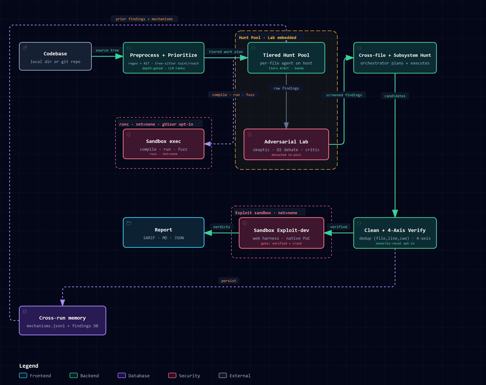

<p align="center">
  
</p>

<p align="center"><strong>Finds the bug · Writes the exploit · Proves it's real</strong></p>

Acuario audits source code the way an attacker would, and it does not stop at
pointing out a weakness. It finds the vulnerability, writes a working exploit
for it, stands your application up inside a live but sealed-off sandbox, and
fires that exploit at the running app to see whether the bug is actually real.
Throughout, it records every syscall, request, and agent action inside the
sandbox, so what lands on your desk is proof, not a wall of maybe-bugs.

Behind each run is a team of language-model agents working in disposable Docker
containers, an adversarial reviewer that argues against every candidate finding
before it is allowed to stand, and a deterministic dependency scan for
known-vulnerable packages. Acuario is provider-agnostic: a Rust-backed runtime
(`genai-pyo3`) lets the same pipeline run against any major commercial API or a
model you host yourself, with no code changes and the same orchestration cost.
When you run locally the summary shows `$0.00` paid next to a reference quote for
what the same token volume would have cost on a current frontier model.

### What a run leaves behind

A finished audit writes a full report set (SARIF for your IDE and code-scanning,
a Markdown write-up, a print-ready PDF, and machine-readable JSON) into
`./results/scanner/<session-id>/` from a git checkout, or
`~/.acuario/results/scanner/<session-id>/` from an installed package. Alongside
the reports it keeps the complete paper trail: every agent's reasoning, the
reviewer's verdicts, and the proof-of-concept transcripts. Any finding traces
back to the exact step that produced it.

### Scope and authorization

Acuario is offensive tooling. Point it only at code you own or have written
permission to examine. Choosing what is in scope, obtaining that permission, and
handling whatever the tool surfaces are decisions that rest with the person
running it, not with the tool.

---

## The lab model

The pipeline is organized like a small security research lab rather than a
single reviewer. Specialist agents hand work between each other, and the
sandboxes they run in can checkpoint and roll back, so a dead-end idea costs
nothing to undo.

**The agents** (`acuario/lab/agents/`). A *skeptic* sits between the analyzer
pool and the findings pool and has to produce a concrete refutation, a real code
reference or a precondition that does not hold, before a finding is admitted;
every accept and reject is logged with its full prompt and response. A
*reflective critic* runs after each analyzer session and asks the model to
re-read its own trajectory for what it missed, feeding low-confidence leads back
through the normal validation flow. A *cross-file orchestrator* reads the
findings pool plus a structural map of the codebase after the per-file pass and
emits investigation plans for shared-state and boundary bugs, which then run as
a follow-up hunt.

**The sandbox** (`acuario/lab/sandbox/`). To stand a live target up, Acuario
brings the application onto an isolated, egress-free Docker network and lets the
exploit agent reach it by service name, so a proof of concept runs against a
real instance. Before each attempt the container is snapshotted with a Docker
commit, and a dead-end hypothesis reverts instantly. When `strace` is available,
per-command instrumentation records the real syscalls an action made and writes
them to `behavior_events.jsonl`, catching, for example, a bare
`open("/etc/passwd")` that never appears in the agent's own transcript. Without
`strace` it degrades to a regex behavior monitor.

Every run also produces `team_discussion.md`: one document gathering each
agent's reasoning on each finding, the analyzer's chain, the skeptic's verdict,
the critic's notes, the reviewer's axis-by-axis rationale, and the exploit
outcome, with nothing truncated.

`docs/lab.md` walks through the lab end to end.

---

## From clone to first audit

### 1. What you need installed

- Python 3.10 or newer, and `git` (the scanner clones and reads the target).
- `ripgrep` (`rg`), the analyzer's code-search tool. Required.
- Docker Engine with the Compose v2 plugin. Agents run in disposable
  containers, and the live-exploit stage brings target apps up with
  `docker compose`. On most distributions Compose v2 is a **separate package**;
  `docker.io` / `docker-ce` on its own does not include it.
- Nice to have: `gh` (for `--auto-pr` / `--github-checks`) and `gdb`
  (in-sandbox debugging).

On Debian or Ubuntu:

```bash
sudo apt install -y git ripgrep docker.io docker-compose-v2
sudo usermod -aG docker "$USER"   # re-login so the group takes effect
```

On macOS, Docker Desktop already bundles Compose v2:

```bash
brew install git ripgrep && brew install --cask docker
```

You will also need an LLM endpoint: a commercial API key, a local server you
run (Ollama, LM Studio, vLLM), or any OpenAI-compatible URL. The `setup` wizard
in step 3 covers all of them.

### 2. Install

`uv` is the smooth path. It reads `pyproject.toml` and the lock file and builds
a pinned environment under `.venv/`. No Rust toolchain is needed, since the
`genai-pyo3` runtime ships as prebuilt wheels.

```bash
git clone https://github.com/dsci-in/acuario.git
cd acuario
uv sync --all-extras
source .venv/bin/activate
acuario --version
```

No `uv`? Install it with `curl -LsSf https://astral.sh/uv/install.sh | sh`, or
skip it and use a plain virtualenv with `pip install -e '.[dev]'` (you lose
lock-file pinning).

### 3. Point it at a model

The wizard walks the whole provider decision, stores the result in
`~/.acuario/config.yaml`, and can fire a live test before you leave it:

```bash
acuario setup
```

Its menu covers Anthropic, OpenAI (Chat, Responses, and OAuth), OpenRouter,
Together, Groq, Fireworks, DeepSeek, MiniMax, the local servers (Ollama, vLLM,
LM Studio), and a custom catch-all for anything OpenAI-compatible. For the local
servers it queries your endpoint for its model list so you can pick by number.

### 4. Check the environment

```bash
acuario doctor
```

Doctor probes your Python and Acuario versions, resolves the LLM provider,
checks Docker reachability and the Compose plugin, looks for the external tools
(`git`, `ripgrep`, `gh`, `gdb`), confirms `~/.acuario/` is writable, and tries
the network path to your endpoint, then prints a single PASS / WARN / FAIL
verdict. Add `--json` for a machine-readable version.

### 5. Audit something

`audit` accepts a local folder, an absolute path, or a remote git URL (which it
clones for you).

```bash
acuario audit . --depth quick       # fast triage, no analyzer pool
acuario audit . --depth standard    # the real pipeline
acuario audit https://github.com/example/project --depth standard
```

Run `acuario help` for the command list, or `acuario help <command>` for any one
of them.

---

## Choosing a depth

| Depth      | What it runs                                                                                        | Rough cost on a commercial API |
|------------|-----------------------------------------------------------------------------------------------------|--------------------------------|
| `quick`    | Preprocessor, LLM prioritizer, static patterns. No analyzer pool or sandbox.                        | close to free                  |
| `standard` | Everything in `quick` plus the analyzer pool, the 4-axis reviewer, taint and reachability, mechanism memory, and exploit-dev. **Default.** | roughly \$10 to \$50 on Claude Sonnet |
| `deep`     | Everything in `standard` plus entry-point sharding, wider promotion bands, and analyzer ptrace monitoring. | higher                         |

Sandboxed proof-of-concept generation on crash-reproduced findings runs by
default; turn it off with `--no-exploit`. The optional variant loop is
`--variant-loop`, and the separate `--exploit` flag asks the analyzers to
attempt exploit-writing during the hunt itself.

For a **live** proof of concept the target app is brought up on an isolated,
egress-free network and the exploit agent reaches it by service name. Acuario
tries, in order, an `acuario.host.yml` recipe, a `docker-compose.yml`, a root
`Dockerfile`, then an auto-detected Python or Node stack, adding a database
sidecar when it sees a schema. Anything that cannot be stood up (a Windows/.NET
runtime, an unfamiliar stack) falls back to a static proof without failing the
run.

## The files a run writes

Everything lands in the session directory:

| File                     | Who it's for                                                     |
|--------------------------|------------------------------------------------------------------|
| `findings.sarif`         | IDEs and GitHub code scanning                                    |
| `report.md` / `report.pdf` | People: the same report, on-screen and print-ready             |
| `findings.json`          | Scripts and downstream tooling                                  |
| `manifest.json`          | Run metadata: counts, repo, tokens, real cost and reference quote |
| `team_discussion.md`     | The multi-agent debate, per finding, untruncated                |
| `skeptic_log.jsonl`      | Every skeptic decision, with prompt and response                |
| `critic_log.jsonl`       | Every reflective-critic pass                                    |
| `orchestrator_log.jsonl` | Cross-file plans and their reasoning                            |
| `calibration.jsonl`      | Skeptic vs. validator vs. exploit-outcome agreement, for tuning |
| `behavior_events.jsonl`  | Real syscalls captured by the per-command `strace` wrap         |

The end-of-run summary reports tokens used, cost paid (real on commercial APIs,
`$0` self-hosted), and the frontier-model reference quote when you ran locally.

## Going back through past runs

`acuario history` is the way in. On a terminal it is interactive: sessions are
numbered and newest-first, you open one by typing its number, `/text` filters by
repo or id, and `n` / `p` page through a long list. Opening a session drops you
into `inspect`, and `..` takes you back to the list.

```bash
acuario history                 # browse past runs (interactive)
acuario history --repo myproj   # filter non-interactively
acuario inspect <session-id>    # jump straight into one
```

`inspect` is a REPL over a finished audit: `triage` and `list` to see findings,
`show <n|id>` for the full detail of one, `why` and `fix` for LLM explanations,
`..` to step back, `q` to leave. If a session's results directory has been moved
or cleaned up, inspect reads its findings from the local database instead, so
anything in `history` stays openable.

Two more read-only commands round it out. `acuario report <session-id>` re-emits
the reports without touching the model, and `acuario eval <session-id>` prints a
proxy-metric scoreboard (per-source verified rates, skeptic-versus-validator
agreement, and more).

## Picking up a crashed run

A run that dies partway through, whether a network blip, FD exhaustion, or a
reboot, has already persisted its findings. Resume from where it stopped:

```bash
acuario audit --resume <session-id>              # re-review and re-report
acuario audit --resume <session-id> --no-verify  # skip the reviewer, ~30s
```

The serial verifier retries transient network errors on its own, and every
`--resume` is idempotent.

---

## How the pipeline fits together

<p align="center">
  
</p>

<p align="center"><sub>The <code>acuario audit</code> pipeline. Exploit-dev is on by default (<code>--no-exploit</code> disables it); the variant loop is opt-in (<code>--variant-loop</code>). The sandbox defaults to runc with <code>net=none</code>; gVisor, ptrace monitoring, and warm pools are opt-in.</sub></p>

The analyzer's own tools live under `acuario.agent.tools.hunt.*` and run inside
the sandbox during an audit. Around the `audit` command sit eight utility
commands: `setup`, `doctor`, `config`, `history`, `report`, `sessions`,
`inspect`, and `eval`. The internals, sandbox lifecycle, and the reviewer's
4-axis check are documented in `docs/architecture.md`.

## Reference docs

This page is enough to run the tool. Reach for the rest when a specific need
comes up, not before.

| What you're after                                 | Read                                     |
|--------------------------------------------------|------------------------------------------|
| Go past the first run: env vars, routing, troubleshooting | [`docs/quickstart.md`](docs/quickstart.md)       |
| Set up a specific provider                        | [`docs/providers.md`](docs/providers.md)         |
| Look up a flag                                     | [`docs/cli.md`](docs/cli.md)                     |
| Understand the pipeline and sandbox internals     | [`docs/architecture.md`](docs/architecture.md)   |
| Explore the lab agents and the debate report      | [`docs/lab.md`](docs/lab.md)                     |

## Working on Acuario

```bash
uv sync --all-extras && source .venv/bin/activate
pytest -q
ruff check acuario/ tests/
ruff format --check acuario/ tests/
```

Contributions are welcome; [`CONTRIBUTING.md`](CONTRIBUTING.md) has the DCO
sign-off and the dependency rules, and contributors are listed in
[`CONTRIBUTORS.md`](CONTRIBUTORS.md).

## Notices and license

The agentic approach Acuario takes was prompted by Anthropic's Glasswing, which
showed what this kind of pipeline could do. Where that remained closed, Acuario
is an independent, openly available build of the idea, aimed at finding and
actually proving vulnerabilities inside well-contained sandboxes. It also reuses
some MIT-licensed code; those attributions are recorded in
[`THIRD-PARTY-NOTICES.md`](THIRD-PARTY-NOTICES.md).

The project is free software under the
[GNU Affero General Public License v3.0 or later](LICENSE); `acuario --license`
prints the notice. You may use, study, modify, and share it, and under section
13, running a modified version as a network service means offering your users
its source. A few non-binding requests about naming, attribution, and commercial
use live in [`COPYRIGHT`](COPYRIGHT). They are preferences, not conditions.

Copyright (C) 2026 Data Security Council of India.
